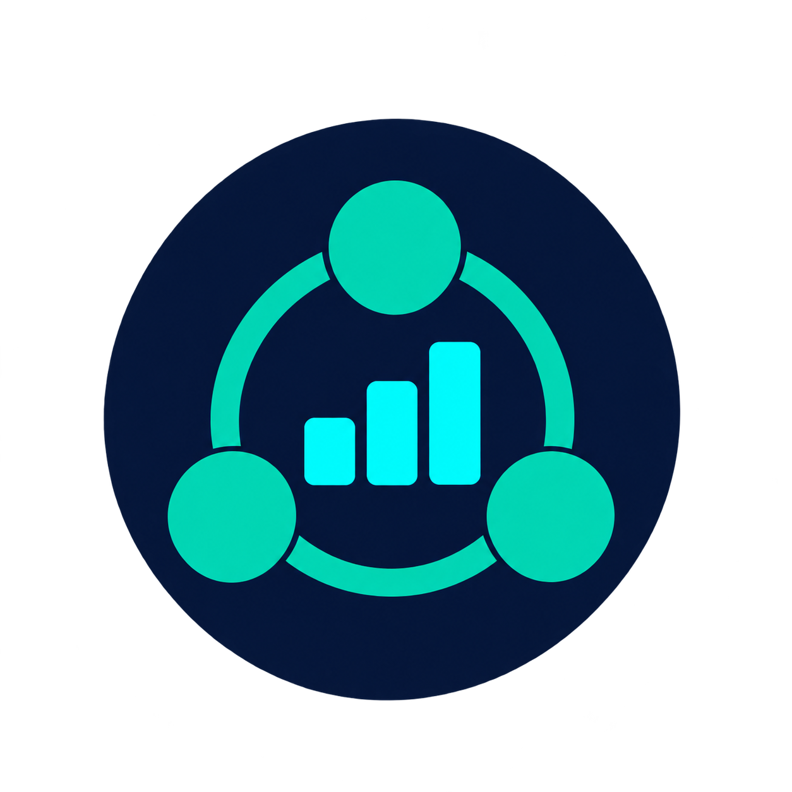

# omada-inside



omada-inside ist ein selbst gehostetes Dashboard für die TP-Link Omada Open API. Es summiert den Datenverkehr am WAN-Port eines verwalteten Gateways und zeigt Änderungen bei WLAN-Clients und Access Points. Die App arbeitet mit einem lesenden API-Zugang.

> **Entwicklung:** omada-inside ist ein Projekt von Wolfgang Kiefer. Der KI-Assistent Codex hat bei der Implementierung, den Tests und der Dokumentation mitgewirkt.
>
> **Development:** omada-inside is a project by Wolfgang Kiefer. The AI assistant Codex contributed to implementation, testing, and documentation.

## Funktionen

- **Internet Traffic** berechnet Empfang, Versand und Gesamtvolumen für den gewählten Zeitraum. Die Tabelle schlüsselt die Werte nach Gateway und WAN-Port auf.
- **WLAN Detektiv** zeigt den AP-Status und eine durchsuchbare Zeitleiste der letzten 24 Stunden. Die App fragt Omada etwa alle 30 Sekunden ab und speichert beobachtete Änderungen in SQLite.
- **Messabdeckung** zeigt an, für wie viele Intervalle Werte vorliegen. Ein Tageswert kann mehrere Stunden oder 5-Minuten-Intervalle abdecken.
- Das Container-Image enthält Anwendung, HTML, CSS und Logo. Portainer benötigt keine zusätzlichen App-Dateien auf dem Docker-Host.

## Voraussetzungen

- Docker Standalone mit Portainer oder Docker Compose.
- Ein vom Container aus über HTTPS erreichbarer Omada Controller mit aktivierter Open API. Für Internet Traffic muss ein kompatibles Omada Gateway in der Site verwaltet werden und historische WAN-Statistiken liefern.
- Eine Open-API-App im Modus **Client**. Lege sie in Omada unter **Globale Ansicht → Einstellungen → Plattformintegration → Open API** an und gewähre Leserechte für die gewünschte Site, ihre Geräte, Clients und Statistiken.
- Ein Docker-Host mit **Linux amd64** oder **Linux arm64**, beispielsweise ein Raspberry Pi mit 64-Bit-System.

Trage Client Secret und andere Zugangsdaten direkt bei der Bereitstellung ein. Die Anmeldung schützt WLAN & VLANs und Admin. Internet Traffic und WLAN Detektiv sind ohne Anmeldung erreichbar. Das Dashboard ist für ein internes Netz vorgesehen. Bei Zugriff von außerhalb des LANs nutze einen vorgeschalteten Zugangsschutz.

## Portainer mit GitHub verbinden

### Öffentliches Repository und öffentliches Image

1. Öffne in Portainer deine **Docker-Umgebung → Stacks → Add stack**.
2. Gib dem Stack den Namen `omada-inside` und wähle **Git Repository**.
3. Kopiere die HTTPS-Clone-URL aus GitHub unter **Code → HTTPS** in **Repository URL**.
4. Lass **Authentication** für ein öffentliches Repository deaktiviert. Verwende als **Repository reference** `refs/heads/main` und als **Compose path** `docker-compose.yml`.
5. Hinterlege unter **Environment variables → Advanced mode** die nachstehenden Variablen. Ersetze `OWNER` durch den kleingeschriebenen GitHub-Owner und die anderen Platzhalter durch deine Werte.
6. Prüfe in GitHub unter **Actions**, ob **Container image** erfolgreich gelaufen ist. Klicke danach in Portainer auf **Deploy the stack**. Das Dashboard ist standardmäßig unter `http://<Docker-Host>:8787` erreichbar.

```dotenv
OMADA_IMAGE=ghcr.io/OWNER/omada-inside:latest
OMADA_URL=https://controller.example.net
OMADA_ID=DEINE_OMADA_ID
OMADA_CLIENT_ID=DEINE_CLIENT_ID
OMADA_CLIENT_SECRET=DEIN_CLIENT_SECRET
OMADA_SITE_ID=
OMADA_VERIFY_TLS=true
APP_TIMEZONE=UTC
DASHBOARD_PORT=8787
```

### Privates Repository oder privates Image

GitHub-Repository und GHCR-Paket haben eigene Zugriffsregeln. Für ein privates Repository aktiviere im Git-Stack **Authentication**. Verwende deinen GitHub-Benutzernamen und einen Token mit Lesezugriff auf das Repository als Passwort. Ein Fine-grained PAT kann auf dieses Repository mit **Contents: Read-only** beschränkt werden, sofern deine Portainer-Version und GitHub-Richtlinien den Token zulassen. Bei einem Classic PAT wird für privaten Git-Zugriff üblicherweise der Scope `repo` benötigt.

Für ein privates Image hinterlege zusätzlich unter **Registries → Add registry → Custom registry** die Registry `ghcr.io`, deinen GitHub-Benutzernamen und einen Classic PAT mit `read:packages`. Der Kontoinhaber braucht Lesezugriff auf das Paket. Wähle diese Registry beim Deploy aus, sofern deine Portainer-Version eine Registry-Auswahl anbietet. Für einen späteren anonymen Zugriff muss auch das GHCR-Paket öffentlich sein. Stelle seine Sichtbarkeit separat in GitHub unter **Packages → omada-inside → Package settings** um.

### Updates

Nach einem erfolgreichen Workflow-Lauf kannst du in Portainer beim Stack **Pull and redeploy** verwenden. Aktiviere den erneuten Image-Pull, damit ein aktualisiertes `latest` geladen wird. Bei GitOps-Polling kann ein Stack-Update erfolgen, bevor der Image-Build abgeschlossen ist. Prüfe bei Bedarf den Workflow und starte den Pull anschließend erneut. Für reproduzierbare Deployments pinne `OMADA_IMAGE` auf einen veröffentlichten Versions-Tag oder Digest.

Quellen für die Portainer-Einstellungen und Paketberechtigungen. [Portainer Git-Stacks](https://docs.portainer.io/user/docker/stacks/add) · [GitHub Container Registry](https://docs.github.com/en/packages/working-with-a-github-packages-registry/working-with-the-container-registry)

## Konfiguration

| Variable | Bedeutung |
| --- | --- |
| `OMADA_IMAGE` | Vollständige Image-Referenz für Compose. |
| `OMADA_URL` | HTTPS-Basisadresse des Controllers aus Sicht des Containers, einschließlich Port falls nötig. |
| `OMADA_ID` | Omada-Controller-ID aus der Open-API-Konfiguration. |
| `OMADA_CLIENT_ID` / `OMADA_CLIENT_SECRET` | Zugangsdaten der Omada Open API. |
| `OMADA_SITE_ID` | Site-ID. Bei genau einer für die App sichtbaren Site kann sie leer bleiben. |
| `OMADA_VERIFY_TLS` | Standard `true`. `false` deaktiviert Zertifikats- und Hostnamenprüfung für die Omada-Verbindung. |
| `APP_ADMIN_PASSWORD` | Passwort für den Benutzer `admin`. Bei leerem Wert sind die Anmeldung sowie WLAN & VLANs und Admin deaktiviert. |
| `WAN_ARCHIVE_START` | Optionaler früherer Startmonat für den historischen Import aller Auflösungen im Format `JJJJ-MM`. |
| `APP_WLAN_KEY` | Separater Fernet-Schlüssel für WLAN-Kennwörter. Nur für Speichern und Anzeigen von Kennwörtern erforderlich. |
| `APP_TIMEZONE` | IANA-Zeitzone für die WAN-Auswertung, Standard `UTC`. Die WLAN-Zeitleiste verwendet UTC. |
| `DASHBOARD_PORT` | Port auf dem Docker-Host, Standard `8787`. |
| `OMADA_HISTORY_VOLUME` | Name des Docker-Volumes für SQLite, Standard `omada-inside_history`. |

Das Volume wird bei einer Neuinstallation automatisch erstellt. Bei einer Migration stoppe die alte Instanz und sichere zuerst ihr Volume. Verwendest du bereits denselben Stack und dasselbe Volume, kannst du es weiterverwenden. Für ein von einem anderen Stack verwaltetes Volume kopiere die SQLite-Datei in das neue Volume oder passe Compose explizit an, damit das alte Volume als extern eingebunden wird. Für die Auswahl derselben SQLite-Datei müssen Omada-URL, Omada-ID und der konfigurierte Wert von `OMADA_SITE_ID` wie bisher lauten.

## Eigenes Logo hochladen

1. Setze in Portainer unter **Environment variables → Advanced mode** die Variable `APP_ADMIN_PASSWORD` auf ein eigenes, starkes Passwort und deploye den Stack erneut. Öffne die Admin-Seite für die Anmeldung über HTTPS, beispielsweise über einen Reverse Proxy.
2. Melde dich oben im Dashboard mit `admin` und dem konfigurierten Passwort an. Öffne den daraufhin eingeblendeten Reiter **Admin**.
3. Wähle ein PNG (maximal 2 MiB und 4096 × 4096 Pixel) und klicke auf **Logo speichern**.

Das Logo wird als PNG in derselben SQLite-Datenbank wie die WLAN-Historie gespeichert. Mit demselben Datenvolume und denselben Omada-Identifikationswerten bleibt es bei einem Image-Update erhalten. Sichere das Volume, wenn das Logo und die WLAN-Historie auch nach einem Ausfall des Docker-Hosts wiederherstellbar sein sollen. Ohne Upload zeigt die App das mitgelieferte Logo.
Die Anmeldung gilt für **WLAN & VLANs** und **Admin**. Die Sitzung endet nach acht Stunden, beim Abmelden oder beim Neustart des Webcontainers. Verwende HTTPS für den Zugriff über das Netzwerk.

Unter **Admin → Darstellung** kannst du den Namen in der Kopfzeile und im Browsertab ändern. Die Einstellung wird in SQLite gespeichert. Ein leeres Feld setzt den Namen auf `omada-inside` zurück.

Ein eigenes Favicon kannst du unter **Admin → Darstellung → Favicon** als PNG hochladen. Die Vorschauen zeigen 16 und 32 Pixel. Mit **Zurücksetzen** verwendet die App das gespeicherte Dashboard-Logo oder das Standardsymbol. Ein vorhandenes Dashboard-Logo wird beim Update automatisch übernommen.

## WLAN- und VLAN-Dokumentation

Unter **WLAN & VLANs → Jetzt mit Omada abgleichen** liest die App die LAN-Netze, WLAN-Gruppen und SSIDs der konfigurierten Site aus Omada. Die Open-API-Rolle braucht Leserechte für diese Listen. Der Abgleich übernimmt Namen, VLAN-Informationen und, soweit verfügbar, den SSID-Sicherheitstyp. Der manuelle Abgleich liest außerdem die SSID-Details von WPA-Personal und die verknüpften lokalen PPSK-Profile. Dafür braucht die Open-API-Rolle Zugriff auf beide Detailabfragen. Der Zugriff auf Omada erfolgt lesend.
In der VLAN-Übersicht steht das IPv4-Subnetz neben der VLAN-ID, sofern Omada es liefert. Nach einem Update füllt der nächste manuelle Abgleich diese Angabe.

Öffne **WLAN & VLANs** über HTTPS. Klappe eine SSID oder ein VLAN in der Liste auf, um direkt darunter Notizen und gegebenenfalls Zugänge zu bearbeiten. Für Kennwörter erzeuge einen eigenen Schlüssel auf deinem Rechner:

```sh
python3 -c 'import base64, secrets; print(base64.urlsafe_b64encode(secrets.token_bytes(32)).decode())'
```

Speichere ihn in Portainer unter **Environment variables → Advanced mode** als `APP_WLAN_KEY` und deploye den Stack erneut. Bei einer einfachen SSID kannst du einen Zugang dokumentieren. Bei PPSK-SSIDs kannst du mehrere Zugänge mit Bezeichnung, Kennwort, Ziel-VLAN und Notiz anlegen. Kennwörter werden verschlüsselt in SQLite gespeichert und erst auf Anforderung einzeln in der Admin-Ansicht angezeigt. Für eine Wiederherstellung sichere Datenvolume und Schlüssel separat.
Die Zugangstabelle kennzeichnet importierte Einträge mit der Quelle **Omada**. Manuelle Zugänge lassen sich direkt unter ihrer Zeile bearbeiten. Ein PPSK-Eintrag zeigt Profil, Bezeichnung und Ziel-VLAN, sofern der Controller diese Angaben liefert. Mit gültigem `APP_WLAN_KEY` speichert die App gelieferte Kennwörter verschlüsselt. Maskierte oder fehlende Werte werden als solche behandelt. Ein bereits importiertes Kennwort bleibt in diesem Fall als zuletzt gespeicherter Wert verfügbar. Manuelle Zugänge und Notizen bleiben beim Abgleich erhalten. Bei einem fehlgeschlagenen Detailabruf bleibt der bisherige Importstand dieser SSID erhalten.

**Aktiv** bedeutet, dass der Eintrag beim letzten vollständigen Abgleich gefunden wurde. Fehlende Objekte werden beim erfolgreichen Abgleich inaktiv. Notizen und Zugänge bleiben erhalten und sind über **Inaktive anzeigen** erreichbar. Schlägt eine Teilabfrage fehl, bleiben die bisherigen Status bestehen. Nach einer Umbenennung findet der Worker dasselbe Objekt anhand der Omada-ID und Site wieder.

## Internet Traffic verstehen
Öffne **Verbrauchskalender** für die Tageswerte eines Monats und den Vergleich mit dem Vormonat. Klick auf einen Tag zeigt Empfang und Versand je WAN-Port. Die Übersicht nutzt Omadas Tagesstatistik und ordnet den gelieferten Zeitstempel anhand von `APP_TIMEZONE` zu. Fehlende Werte sind erkennbar. Im laufenden Monat zeigt die gelbe Kachel den heutigen Verbrauch aus verfügbaren abgeschlossenen 5-Minuten-Intervallen. Dieser vorläufige Wert steht separat von der Summe abgeschlossener Tage. Die Monatssummen enthalten die verfügbaren Werte, die Abdeckung steht jeweils daneben.

Die App summiert empfangene und gesendete Bytes aus Omadas WAN-Portstatistik. Die Anzeige verwendet dezimale Einheiten. Ein GB entspricht einer Milliarde Bytes. Die angezeigten Einzelwerte sind gerundet.

Bei kurzen oder nicht auf volle Stunden begrenzten Zeiträumen beginnt die App mit 5-Minuten-Werten. Für längere Zeiträume mit vollen Stundengrenzen beginnt sie mit Stundenwerten. Fehlen für einen vollständigen Kalendertag feinere Werte, kann ein eindeutiger Tageswert diese ersetzen. Für angebrochene Tage bleiben fehlende Werte sichtbar. Wähle für einen vollen Monat als Endzeit den ersten Tag des Folgemonats um 00:00 Uhr.

Die verfügbare Historie hängt vom Gateway, von der Open API und von Omadas Aufbewahrung für 5-Minuten-, Stunden- und Tagesstatistiken ab. Große Abfragen können länger dauern. Freie Zeitraumabfragen verwenden für abgeschlossene Monate SQLite. Im laufenden Monat lädt die freie Abfrage fehlende Abschnitte live aus Omada. Der Verbrauchskalender zeigt den aktuellen Monat weiterhin live an. Summen zählen überlappende Auflösungen nur einmal.

### WAN-Archiv

Compose startet zusätzlich den Container `omada-inside-worker` ohne veröffentlichten Port. Beide Dienste verwenden dasselbe lokale Docker-Volume und dieselbe SQLite-Datei im WAL-Modus. Für ein Update behalte die bisherige Volume- und Controller-Konfiguration bei. Der Worker protokolliert neue Messpunkte und Fehler in seinen Container-Logs.

Beim ersten Start und nach der Schemamigration importiert der Worker Messpunkte bis einschließlich gestern. Für den Suchbeginn verwendet er den ältesten bereits archivierten Monat oder mindestens die letzten 366 Tage. Ist ältere Omada-Historie bekannt, setze `WAN_ARCHIVE_START` auf den frühesten relevanten Monat. Omada liefert hier keine verlässliche älteste Zeitgrenze. Der Worker sucht in stabilen Zeitfenstern in allen drei Auflösungen, auch jenseits der gemeldeten Aufbewahrungszeit. Erfolgreich geprüfte Fenster werden für die Wiederaufnahme gespeichert. Leere Fenster beenden den Import nicht.

Der reguläre Lauf beginnt täglich um **02:00 Uhr in `APP_TIMEZONE`** und fragt die vom Controller gemeldeten Aufbewahrungsfenster für neue und verspätete Werte erneut ab. Versäumte Läufe holt der Worker beim Start nach. In **Admin** findest du App- und Worker-Build, SQLite-Schema, Importstatus, Laufhistorie und ein Zeitband mit der Archivabdeckung. Die Oberfläche bietet die Modi **Hell**, **Dunkel** und **System**.

Jeder Messpunkt bleibt mit Gateway, WAN-Port, Auflösung, API-Zeitstempel, Empfang und Versand erhalten. Der Worker fügt fehlende Punkte hinzu und überschreibt vorhandene Werte nicht. Der Kalender bevorzugt pro Port einen Tageswert. Fehlt er, verwendet er Stundenwerte und ergänzt freie Stundenabschnitte mit 5-Minuten-Werten. Für diese Zusammenführung interpretiert der Kalender feine Zeitstempel als Intervallbeginn. Fehlende Intervalle sind als teilweise Abdeckung sichtbar. [Omada Open API](https://use1-omada-northbound.tplinkcloud.com/doc.html) · [Omada Controller User Guide](https://support.omadanetworks.com/en/document/111217/)

## Lokal bauen und starten

```sh
docker build -t omada-inside:local .
```

Hinterlege die oben gezeigten Konfigurationsvariablen in einer lokalen `.env` und setze `OMADA_IMAGE=omada-inside:local`. Starte den Stack mit `docker compose up -d`. Die Datei `.env` wird von Git ignoriert.

## Versionen und Release Notes

Für Portainer kann `OMADA_IMAGE` auf `:latest` bleiben. Dieser Tag folgt erfolgreichen Builds auf `main`. Versions-Tags wie `v0.1.0` markieren feste Stände und bauen ein gleichnamiges Image.

Änderungen für die nächste Version sammeln wir unter **Unveröffentlicht** im [Changelog](CHANGELOG.md). Für ein Release erhält der Abschnitt eine Versionsnummer und ein Datum. Der zugehörige Git-Tag startet den Build des Versions-Images. Die GitHub Release Notes übernehmen den Inhalt des Versionsabschnitts.

## Wie GitHub das Image baut

Der Workflow [Container image](.github/workflows/image.yml) läuft bei Pushes auf `main`, Tags mit dem Präfix `v` sowie bei manueller Auslösung. GitHub Actions baut beide Linux-Architekturen und veröffentlicht das Image unter `ghcr.io/<owner>/<repo>`. Auf dem Standardbranch gibt es den Tag `latest`. Zusätzlich erzeugt der Workflow einen Commit-Tag und gegebenenfalls einen Versions-Tag. Der integrierte `GITHUB_TOKEN` des Workflows erhält `packages: write`. Ein persönlicher Token als Workflow-Secret ist dafür nicht nötig. [GitHub-Dokumentation zum Image-Push](https://docs.github.com/en/actions/tutorials/publish-packages/publish-docker-images)

## Fehlersuche

| Meldung oder Symptom | Prüfung |
| --- | --- |
| Repository kann nicht geklont werden | Clone-URL, Branch und bei privaten Repositories das Git-Credential prüfen. |
| Image-Pull endet mit `denied` oder `unauthorized` | GHCR-Sichtbarkeit, Registry-Credentials und Paketberechtigung prüfen. |
| `manifest unknown` | Image-Pfad und Tag mit dem erfolgreichen Actions-Run abgleichen. |
| `Anmeldung · SSLCertVerificationError` | URL und Zertifikat des Controllers prüfen. Der Hostname muss zum Zertifikat passen, die ausstellende CA muss im Container vertrauenswürdig sein. |
| Keine eindeutige Site | `OMADA_SITE_ID` auf die gewünschte sichtbare Site setzen. |
| Kein verwaltetes Gateway oder fehlende WAN-Werte | Site, API-Leserechte und die Statistik für denselben Zeitraum am Gateway prüfen. |
| Kein Zugriff auf das Dashboard | Docker-Host, veröffentlichten Port und Container-Logs prüfen. |

## Projektstruktur

```text
app.py                   API-Abfragen, Auswertung und Webserver
templates/               HTML-Templates für beide Reiter
assets/                  Stylesheet und App-Logo
docker-compose.yml              Docker-Stack für Portainer und Compose
Dockerfile               Container-Image
.github/                 GitHub Actions Workflow für Build und GHCR-Push
```

## Lizenz

omada-inside steht unter der [MIT-Lizenz](LICENSE). Du darfst den Code verwenden, verändern und weitergeben, wenn du den Copyright- und Lizenzhinweis beibehältst. Änderungen am Original-Repository setzen GitHub-Schreibrechte voraus. Eigene Änderungen kannst du in einem Fork veröffentlichen. Dieses Repository nimmt keine Pull Requests an.
